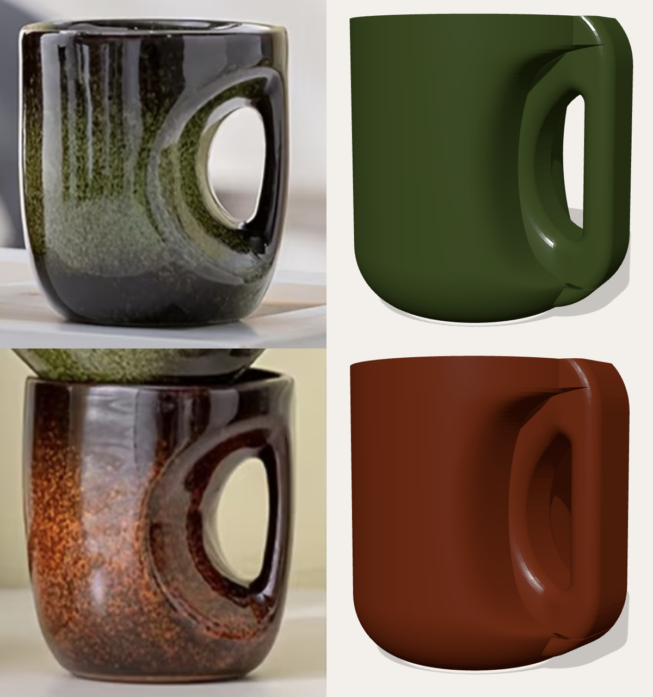
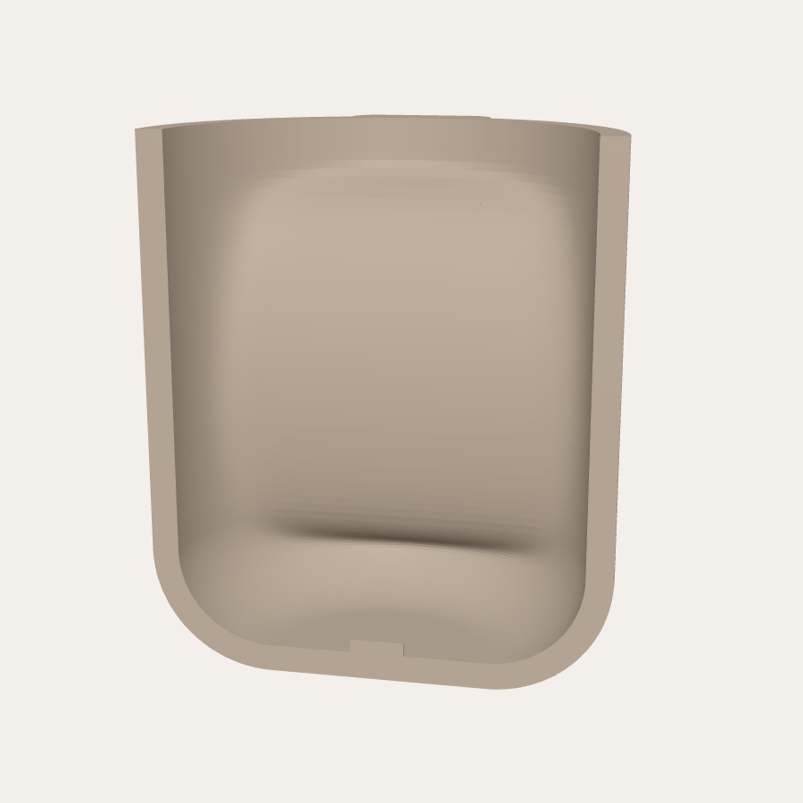
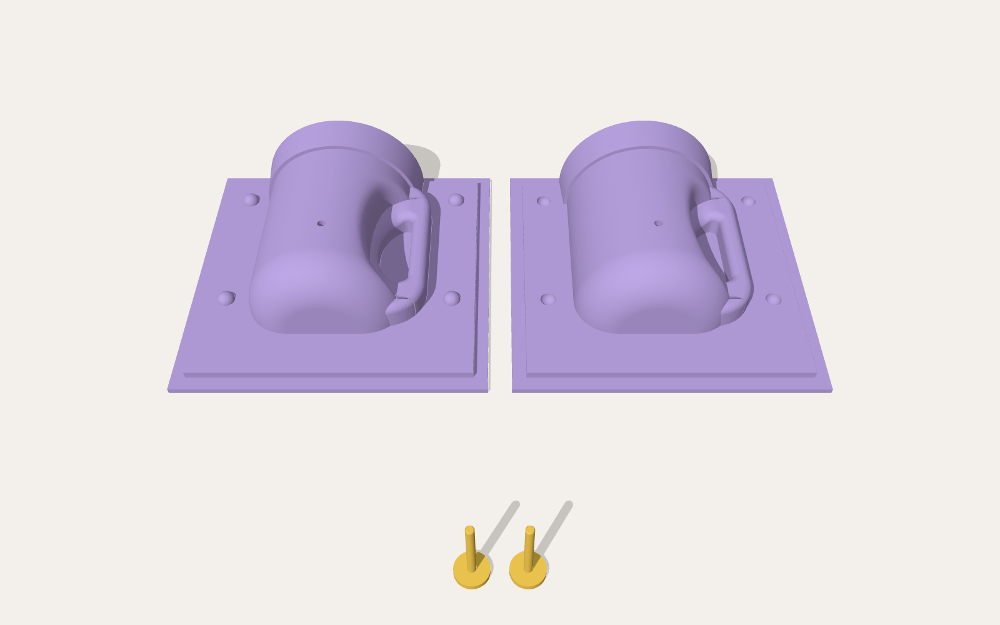

# Guia da caneca com alça de furo: molde de gesso de 2 partes para barbotina

*Escola de cerâmica Barro na Veia*

Caneca de corpo quase reto, com fundo em "U". Ela tem uma **alça em bloco**, grossa, com um **furo em "D"** para o dedo.

Igual às fotos de referência, a parede do corpo **afunda em volta do furo, formando uma concha curva e macia**, maior que o furo. O lado curvo do furo é a própria concha. Por dentro, a parede acompanha e forma a **barriga interna**.

## Medidas

Medidas da caneca da foto de referência: **8 cm de altura, 7,7 cm de largura com a alça e 180 ml**. O molde é **20% maior**, para compensar a retração da barbotina.

| | Caneca pronta (queimada) | Peça que sai do molde (crua) |
|---|---|---|
| Altura | **8,0 cm** | 9,6 cm |
| Largura com a alça | **7,7 cm** | 9,2 cm |
| Capacidade (até a borda) | **180 ml** | – |
| Diâmetro do corpo | 6,9 cm | 8,2 cm |
| Grossura da alça | 2,2 cm | 2,6 cm |
| Furo em "D" | ~1,3 × 4,0 cm | ~1,6 × 4,8 cm |

O diâmetro do corpo foi calculado para dar 180 ml com 8 cm de altura, já contando a barriga interna.

### Como é a alça (igual às fotos)

- **Alça em bloco:** ela quase não sai do corpo, porque a largura total da caneca já a inclui. O topo fica rente à borda, e a barra de fora é arredondada.
- **Furo em "D":** lado reto para fora e lado curvo redondo, entrando fundo no corpo.
- **Lábio:** uma borda arredondada da alça contorna o lado curvo do furo.
- **Sulco em meia-lua:** em volta do lábio, o corpo afunda num sulco que vai de perto da borda até perto do fundo.
- **Barriga interna:** a parede de dentro acompanha o sulco e avança para dentro no lado da alça.





## Como é o molde

É **um molde só, de 2 metades**, divididas pelo meio da alça.
- **Furo:** cada metade forma metade do furo, e as duas se encontram no meio.
- **Concha em volta do furo:** a parede só recua conforme se afasta do meio da alça, na direção em que as metades abrem, então **não prende** o gesso.
- **Encaixe:** as metades encaixam por 4 chaves de registro.
- **Marca:** cada metade sai com o **logo Barro na Veia** gravado na lateral.

Montado, o molde forma um bloco de **13,4 × 14,4 × 14,1 cm**.

## Peças (pasta `stl/caneca/`)



| Arquivo | Imprimir | O que é | Tamanho (mm) |
|---|---|---|---|
| `bandeja_A.stl` | 1x | Meia caneca deitada com meia alça, reservatório, 4 **bolinhas** de encaixe e canal de ar. Gera a **metade A**. | 158 × 155 × 52 |
| `bandeja_B.stl` | 1x | Igual, com 4 **covinhas** de encaixe. Gera a **metade B**. | 158 × 155 × 52 |
| `moldura_U.stl` | 1x | Metade da moldura que cerca a bandeja. | 172 × 74 × 71 |
| `moldura_U_logo.stl` | 1x | A outra metade, com o **logo** em relevo por dentro. | 172 × 74 × 71 |
| `presilha.stl` | 4x | Trava as duas metades da moldura. | 14 × 13 × 20 |
| `pino.stl` | 2x | Tampa o canal de ar das bandejas. | Ø 16 × 39 |

`peca_caneca_conferencia.stl` é só a caneca pronta, para conferir o formato. Não precisa imprimir.

Tudo cabe numa impressora com mesa de 22 × 22 cm, como a Ender 3 V3 KE.

**Impressão:**

- As bandejas vão com a placa na mesa, sem suportes. Use camada de 0,12–0,16 mm e **lixe bem** a meia caneca e a alça.
- A moldura vai em pé. Use as configurações do Creality Print da pasta `impressao/creality_print/`.
- Os pinos vão em pé, com 100% de preenchimento. Passe uma broca de 4 mm nos canais.

## Fazendo as duas metades de gesso

Faça uma metade de cada vez: primeiro com a `bandeja_A`, depois com a `bandeja_B`. A moldura é a mesma.

1. **Pino:** encaixe o pino por baixo da bandeja, até a ponta ficar rente à superfície da caneca.
2. **Moldura:** encaixe as duas metades da moldura no degrau da placa. Prenda com 2 presilhas em cada emenda.
3. **Vedação e desmoldante:**
    - Vede as emendas por fora com argila.
    - Vede também a junção da caneca com a parede da moldura, do lado do reservatório.
    - Passe desmoldante em tudo, inclusive no furo da alça e nas letras do logo.
4. **Gesso:** consistência 70 (70 de água para 100 de gesso). **Por metade:** ~1,1 kg de gesso e ~0,75 L de água.
    1. Despeje pela lateral até a borda da moldura.
    2. Bata na mesa para subir as bolhas.
5. **Desmolde:**
    1. Espere o gesso esquentar e esfriar.
    2. Tire a moldura, vire o conjunto e puxe o pino.
    3. Injete ar ou água com a seringa no canal.
6. Chanfre as quinas e deixe secar **7 dias**.

## Colando a caneca

**A alça é grossa (2,6 cm na peça crua).** Para ela sair **maciça**, a barbotina precisa ficar mais tempo no molde. Se escorrer cedo, a alça sai oca, com uma fenda por dentro da caneca.

1. **Monte o molde:** junte as metades, encaixando as chaves. Prenda com elásticos largos. A boca do reservatório fica para cima.
2. **Encha:** barbotina de colagem (1,75–1,80 g/ml) até o topo do reservatório. Vá completando enquanto o nível baixa.
3. **Espere a parede formar:** a parede do corpo forma em 10–15 min, mas espere **25–35 min** para a alça encher. Para conferir, raspe com a unha a barbotina na parede do reservatório: a parede deve estar com uns 6 mm.
4. **Escorra:** vire de boca para baixo por 10–15 min.
5. **Confira a alça:** olhando por dentro, na altura da alça, não pode haver fenda. Se houver, encha a fenda com barbotina grossa usando uma seringa e alise.
6. **Corte:** quando o brilho sumir, corte a sobra seguindo o degrau.
7. **Abra:** quando a peça começar a se soltar, tire os elásticos e abra as metades **de lado**.
8. **Acabamento:** passe esponja úmida na linha de emenda (no meio da alça, no fundo e no lado oposto) e na borda.
9. **Secagem:** seque devagar, coberta com plástico nos primeiros dias, porque a alça grossa seca mais devagar que o corpo.

## Outros tamanhos

```bash
python3 gerar_caneca.py --altura 100 --largura-total 98 --capacidade 300   # caneca maior
python3 gerar_caneca.py --alca-espessura 18 --alca-espessura-base 18   # alça mais fina (enche mais fácil)
python3 gerar_caneca.py --furo-altura 46                                # furo mais alto
python3 gerar_caneca.py --labio-furo 5 --sulco-extra 12 --concha-maciez 4   # lábio e sulco
python3 gerar_caneca.py --aumento 15                                   # outra retração
python3 gerar_caneca.py --help
```
