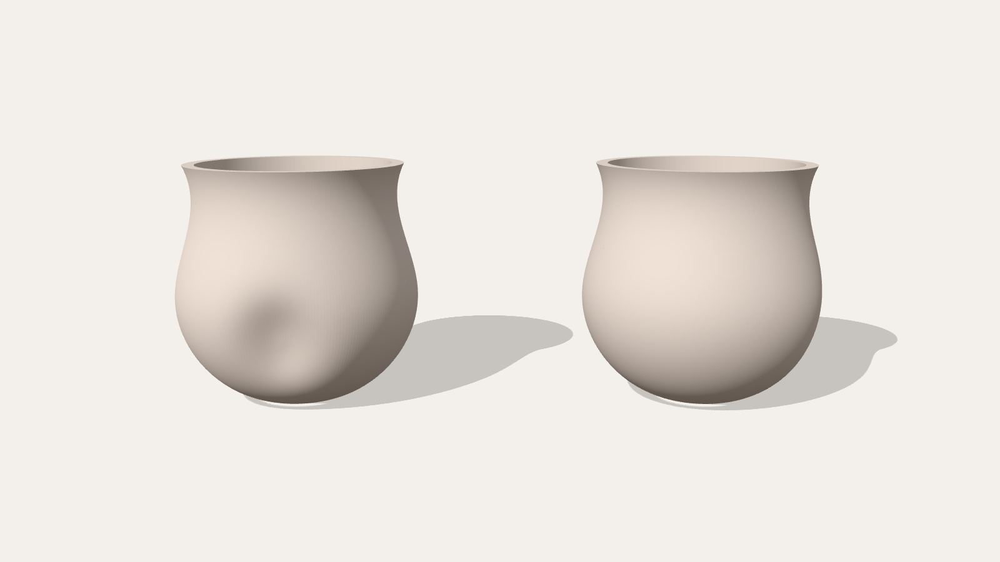
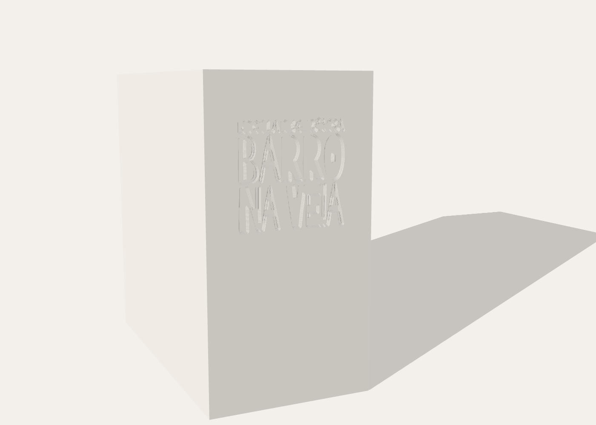

# Guia do copinho barrigudo: molde de gesso de 2 partes para barbotina

*Escola de cerâmica Barro na Veia*

Copinho com **fundo bem redondo**, barriga, pescoço levemente fechado e boca abrindo de leve. Tem **uma covinha** (marca de dedo) de um lado.

| Medida (peça crua, como sai do molde) | |
|---|---|
| Altura | **7,0 cm** |
| Boca (diâmetro externo) | **6,3 cm** |
| Barriga (parte mais larga, a ~2,6 cm do apoio) | **~7,1 cm** |
| Covinha | ~3 cm de largura, ~0,65 cm de fundura, na altura da barriga |

Medidas tiradas das fotos com régua e do vídeo da peça girando.



## Por que 2 partes?

A **barriga (7,1 cm) é mais larga que a boca (6,3 cm)**. Num molde inteiriço a peça ficaria presa. Por isso o molde é dividido em **duas metades na vertical**, passando pelo eixo do copinho:
- a **covinha** fica bem no meio da metade A, e sai reto, sem prender;
- as metades encaixam por **4 chaves de registro**: bolinhas numa metade, covinhas na outra;
- cada metade sai com o **logo Barro na Veia** gravado na lateral.

Montado, o molde é um bloco de **12 × 12 × 11,5 cm**.

## Peças (pasta `stl/copinho/`)


| Arquivo | Imprimir | O que é | Tamanho (mm) |
|---|---|---|---|
| `bandeja_A.stl` | 1x | Meio copinho deitado **com a covinha**, reservatório, 4 bolinhas e canal de ar. Gera a **metade A**. | 136 × 129 × 43 |
| `bandeja_B.stl` | 1x | Meio copinho deitado **liso**, 4 covinhas de encaixe e canal de ar. Gera a **metade B**. | 136 × 129 × 43 |
| `moldura_U.stl` | 1x | Metade da moldura que cerca a bandeja. | 150 × 62 × 65 |
| `moldura_U_logo.stl` | 1x | A outra metade da moldura, com o **logo** em relevo por dentro. | 150 × 62 × 65 |
| `presilha.stl` | 4x | Trava as duas metades da moldura, 2 por emenda. | 14 × 13 × 20 |
| `pino_A.stl` | 1x | Pino do canal de ar da bandeja A. | Ø 16 × 26 |
| `pino_B.stl` | 1x | Pino do canal de ar da bandeja B. | Ø 16 × 33 |

`peca_copinho_conferencia.stl` é só a peça, para conferir o formato. Não precisa imprimir.

Tudo cabe numa impressora com mesa de 22 × 22 cm, como a Ender 3 V3 KE.

**Impressão:**

- As bandejas vão com a placa na mesa e o meio copinho para cima, sem suportes. Use camada de 0,12–0,16 mm e **lixe bem** o meio copinho: a barbotina copia tudo.
- A moldura vai em pé. Use as configurações do Creality Print da pasta `impressao/creality_print/`.
- Os pinos vão em pé, com a cabeça na mesa e 100% de preenchimento. Passe uma broca de 4 mm nos canais das bandejas.

## Fazendo as duas metades de gesso

Faça uma metade de cada vez: primeiro com a `bandeja_A`, depois com a `bandeja_B`. A moldura é a mesma.

1. **Pino:** encaixe o pino certo (A ou B) por baixo da bandeja, até a ponta ficar rente à superfície do meio copinho.
2. **Moldura:** encaixe as duas metades da moldura em volta do degrau da placa. Prenda com 2 presilhas em cada emenda.
3. **Vedação:** vede as emendas por fora com argila. Vede também a junção do meio copinho com a parede da moldura, do lado do reservatório.
4. **Desmoldante:** passe em tudo, inclusive dentro das letras do logo.
5. **Gesso:** consistência 70 (70 de água para 100 de gesso). **Por metade:** ~0,75 kg de gesso e ~0,5 L de água.
    1. Despeje pela lateral até a borda da moldura.
    2. Bata na mesa para subir as bolhas.
    3. Espere esquentar e esfriar (30–60 min).
6. **Desmolde:**
    1. Tire as presilhas e a moldura.
    2. Vire o conjunto e puxe o pino.
    3. Injete ar ou água com a seringa no canal: a bandeja se solta.
7. Chanfre as quinas e deixe as duas metades secarem **7 dias**.



## Colando o copinho

1. **Monte o molde:** junte as metades, encaixando as chaves. Prenda com elásticos largos. A boca do reservatório fica para cima.
2. **Encha:** barbotina de colagem (1,75–1,80 g/ml) até o topo do reservatório. Vá completando enquanto o nível baixa.
3. **Espere a parede formar:** 8–15 min para 3–4 mm. Para conferir, raspe com a unha a barbotina na parede do reservatório.
4. **Escorra:** vire de boca para baixo por 10 min.
5. **Corte:** quando o brilho sumir, corte a sobra seguindo o degrau.
6. **Abra:** quando a peça começar a se soltar, tire os elásticos e abra as metades **de lado**.
7. **Acabamento:** passe esponja úmida na linha de emenda (dos dois lados e no fundo) e na borda.

## Medidas e retração

As medidas acima são da peça **crua**. A peça das fotos já foi queimada. Se as cópias precisam sair do forno do **mesmo tamanho** que ela, gere o molde maior. Por exemplo:

```bash
python3 gerar_copinho.py --retracao 12
```

Outros ajustes: `--covinha nao`, `--covinha-fundura 5`, `--covinha-altura 25`, `--logo-largura 34`, `--margem-gesso 30` (ver `--help`).
