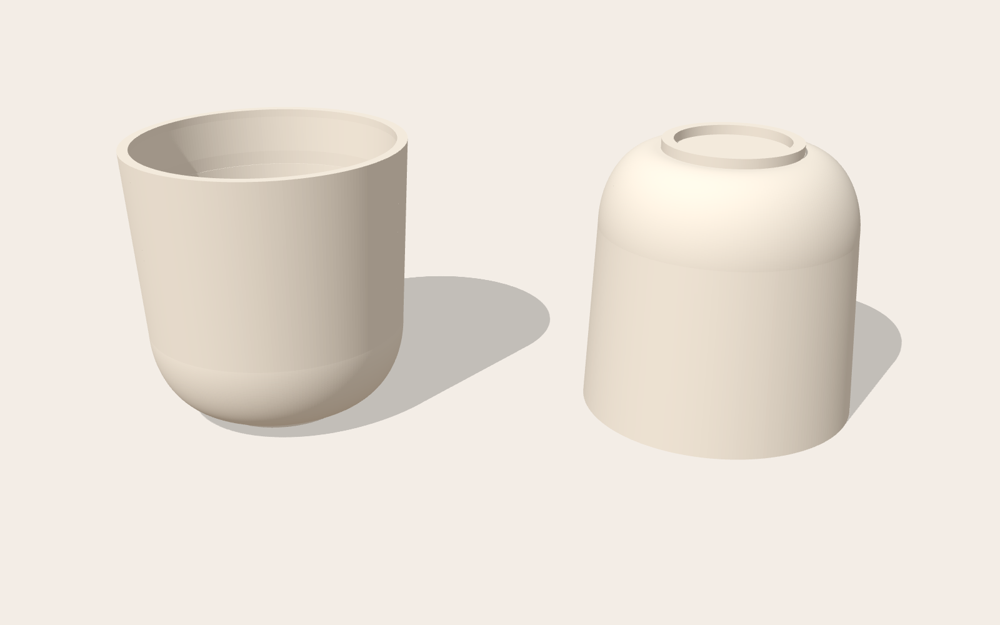
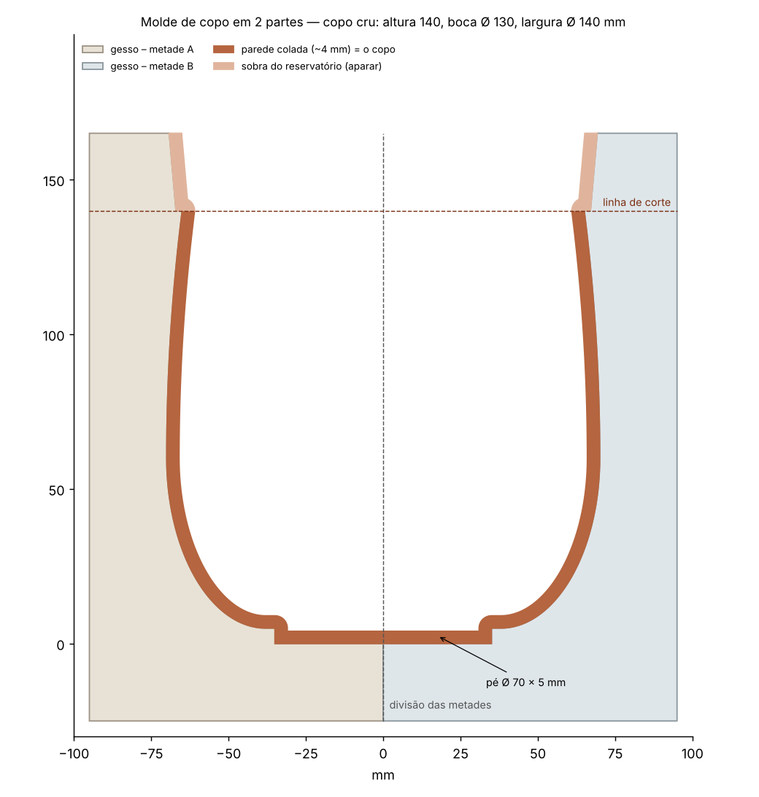
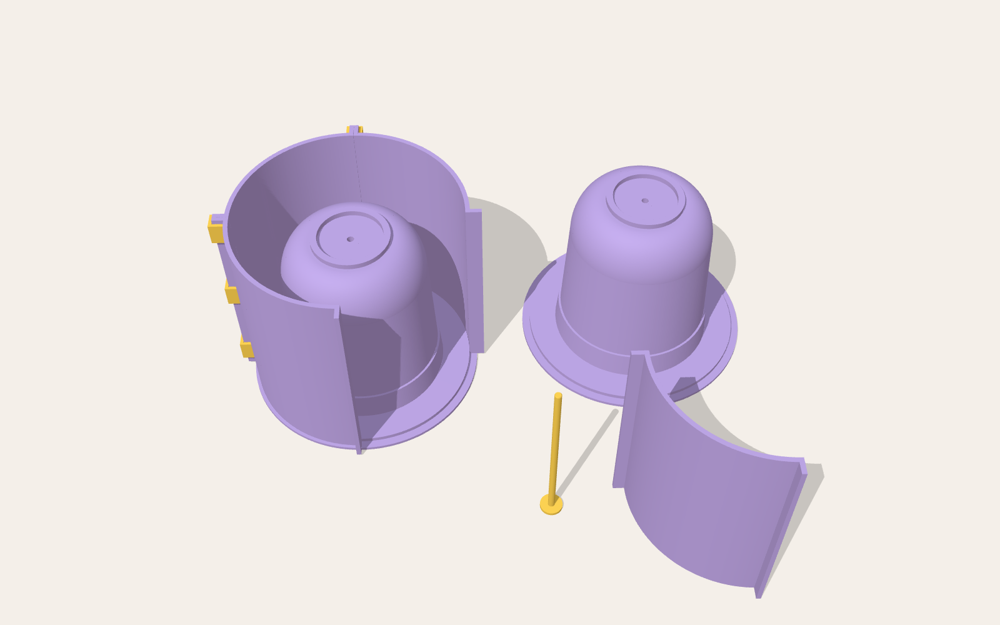
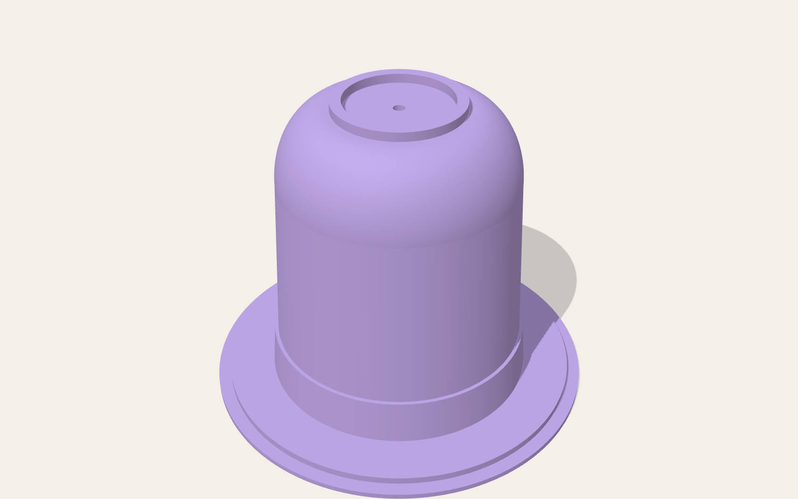
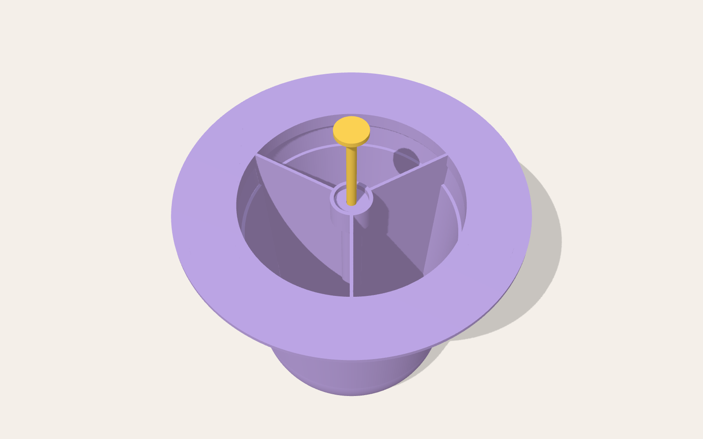

# Guia do copo: molde de gesso para barbotina (1 peça)

*Escola de cerâmica Barro na Veia*

Copo com **fundo bem arredondado**, paredes que abrem levemente até a boca e **pé em anel** no fundo. A boca é a parte mais larga, então o copo sai do gesso por cima. O molde é **de uma peça só**, sem emenda na peça.

| Medida (peça crua, como sai do molde) | |
|---|---|
| Altura (com o pé) | **14 cm** |
| Boca (diâmetro externo, a parte mais larga) | **14 cm** |
| Parede | abre 3° até a boca, o que ajuda a desmoldar |
| Pé | **anel** com Ø 7 cm por fora, 6 mm de largura e **0,5 cm** de altura. O centro fica rebaixado. |





## Peças (pasta `stl/copo/`)



| Arquivo | Imprimir | O que é | Tamanho (mm) |
|---|---|---|---|
| `matriz_copo.stl` | 1x | O **copo de cabeça para baixo** sobre uma aba. A aba tem degraus que formam o encaixe do anel, o **reservatório** e o **degrau de corte**. Por dentro a matriz é **oca**, com um tubo central para o pino e 3 nervuras. | 214 × 214 × 172 |
| `anel_quarto.stl` | **4x** | 1/4 da parede de contenção (Ø interno 200 mm, 194 mm de altura). | 114 × 114 × 194 |
| `presilha.stl` | **12x** | Trava os quartos do anel, 3 por emenda. | 14 × 13 × 20 |
| `pino_desmolde.stl` | 2x | Pino Ø 6 mm que atravessa o tubo central e tampa o furo no fundo do copo. | Ø 20 × 166 |

| Matriz | Matriz por baixo: tubo central, nervuras e pino |
|---|---|
|  |  |


### Baixar as peças

| Peça | Imprimir | Link |
|---|---|---|
| Matriz do copo | 1x | [matriz_copo.stl](https://github.com/alexandrabernal08/barronaveia/blob/claude/affectionate-fermat-465xq0/moldes-3d/stl/copo/matriz_copo.stl) |
| 1/4 do anel | 4x | [anel_quarto.stl](https://github.com/alexandrabernal08/barronaveia/blob/claude/affectionate-fermat-465xq0/moldes-3d/stl/copo/anel_quarto.stl) |
| Presilha | 12x | [presilha.stl](https://github.com/alexandrabernal08/barronaveia/blob/claude/affectionate-fermat-465xq0/moldes-3d/stl/copo/presilha.stl) |
| Pino de desmoldagem | 2x | [pino_desmolde.stl](https://github.com/alexandrabernal08/barronaveia/blob/claude/affectionate-fermat-465xq0/moldes-3d/stl/copo/pino_desmolde.stl) |

**Material extra:**

- gesso cerâmico (~3,8 kg)
- vaselina ou desmoldante
- argila para vedar
- seringa de 60 ml de bico cateter
- barbotina de colagem

**Impressão:**

- A matriz vai com a aba na mesa, sem suportes. Use camada de 0,12–0,16 mm e 3–4 perímetros. O preenchimento quase não importa, porque a matriz já é oca.
- **Lixe bem** a parte do copo e passe primer e verniz: a barbotina copia tudo.
- O anel tem 194 mm de altura. A impressora precisa ter pelo menos 200 mm de altura útil.
- **Pino:** imprima em pé, com a cabeça na mesa, devagar e com 100% de preenchimento.
- **Alternativa ao pino:** uma **cavilha de madeira de 6 mm** cortada com 163 mm, ou uma vareta de 6 mm. Outra opção é tampar o furo do fundo, por fora, com uma bolinha de massinha bem rente. Na hora de desmoldar, o ar da seringa empurra a massinha.
- Passe uma broca de 6 mm no tubo central, de baixo para cima.

## Fazendo o molde de gesso

1. **Pino:** passe vaselina no pino e enfie-o por baixo, pelo tubo central, até a cabeça encostar. A ponta deve ficar rente ao centro do fundo do copo, dentro do anel do pé.
2. **Base:** apoie a matriz na mesa com a aba para baixo.
3. **Anel:** monte os 4 quartos do anel em volta do degrau da aba. O degrau **centraliza sozinho**. Prenda com 3 presilhas por emenda.
4. **Vedação e desmoldante:** vede as emendas por fora com argila e passe desmoldante na matriz e no anel.
5. **Gesso:** use consistência 70, com ~**3,8 kg de gesso** e ~**2,7 L de água**.
    1. Despeje pela lateral, sem jogar direto no copo, até a borda do anel. Isso deixa ~25 mm de gesso acima do pé.
    2. Bata na mesa para subir as bolhas.
6. **Desmolde:**
    1. Espere o gesso esquentar e esfriar (30–60 min).
    2. Tire as presilhas e o anel.
    3. **Vire o bloco** com a matriz ainda dentro, para a aba ficar para cima.
    4. Puxe o pino.
    5. Encaixe uma **seringa de 60 ml de bico cateter** no tubo central e injete ar ou água. A matriz se solta.
7. Chanfre as quinas e deixe o molde secar **7 dias**.

O bloco pronto tem **Ø 20 cm × 19 cm**. A face que estava na aba vira a boca do molde, com o reservatório e o degrau de corte.

## Colando o copo

1. **Encha:** com o molde seco e de boca para cima, encha de barbotina (1,75–1,80 g/ml) até o topo do reservatório. Vá completando enquanto o nível baixa.
2. **Espere a parede formar:** 10–25 min para 4–5 mm. Para conferir, raspe com a unha a barbotina na parede do reservatório.
3. **Escorra:** vire o molde de boca para baixo, apoiado em duas ripas, por 10–15 min.
4. **Corte:** quando o brilho sumir, corte a sobra do reservatório seguindo o degrau.
5. **Desenforme:** espere o copo se soltar sozinho, porque ele retrai e descola. Vire o molde sobre uma espuma.

O anel do pé de 6 mm costuma encher quase maciço de barbotina. É normal.

## Medidas e retração

As medidas são do copo **cru**. Na queima, a barbotina retrai uns 12–15%, então o copo sai do forno com ~12 cm.

Para o copo **queimado** ter 14 cm, gere o molde maior. Nesse caso a matriz e o anel deixam de caber numa mesa de impressão de 220 mm.

```bash
python3 gerar_copo.py --retracao 12 --preview
```

Outros formatos:

```bash
python3 gerar_copo.py --altura 120 --boca 120          # copo menor
python3 gerar_copo.py --saida-parede 6                 # paredes mais abertas
python3 gerar_copo.py --altura-curva 60                # fundo ainda mais arredondado
python3 gerar_copo.py --diametro-pe 60 --altura-pe 4   # outro pé
python3 gerar_copo.py --help
```

| Parâmetro | Padrão | Para que serve |
|---|---|---|
| `--altura` / `--boca` | 140 / 140 | medidas do copo (mm) |
| `--saida-parede` | 3° | quanto a parede abre até a boca. Mínimo de 2° para desmoldar. |
| `--altura-curva` | 45 | até que altura vai a curva do fundo. Maior = fundo mais arredondado. |
| `--diametro-pe` / `--largura-anel-pe` / `--altura-pe` | 70 / 6 / 5 | anel do pé |
| `--retracao` | 0 | % de retração. Use para o copo **queimado** ter as medidas. |
| `--altura-reservatorio` | 25 | sobra acima da boca |
| `--margem-gesso` | 25 | gesso em volta da boca e acima do pé |

