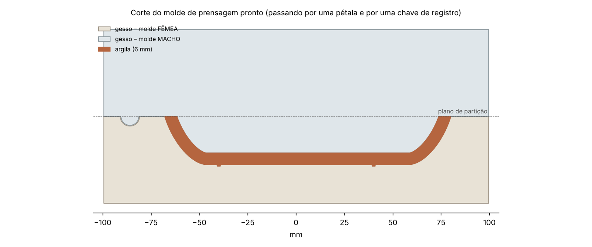

# Moldes 3D para gesso: prato flor

Caixa de contenção impressa em 3D para fazer um **molde de prensagem em gesso de 2 partes** (fêmea + macho) para um prato em forma de flor. É o mesmo sistema das "matrizes" vendidas para ateliês: uma base com o modelo, um anel desmontável e presilhas.


## Peças (pasta `stl/`)

| Arquivo | Imprimir | O que é | Tamanho (mm) |
|---|---|---|---|
| `base_femea.stl` | 1x | Base com o **positivo** do prato em relevo e 3 bolinhas de registro. Gera o molde **fêmea** (côncavo). | 214 × 214 × 33 |
| `base_macho.stl` | 1x | Base com o **rebaixo** do prato (já descontados 6 mm de argila) e 3 covinhas de registro. Gera o molde **macho** (convexo). | 214 × 214 × 25 |
| `anel_metade.stl` | **2x** | Metade da parede da caixa (Ø interno 200 mm, 65 mm de altura). Serve para as duas bases. | 104 × 228 × 65 |
| `presilha.stl` | **4x** | Presilha em "C" que trava as abas das duas metades do anel. | 14 × 13 × 20 |

O prato cru tem **Ø 160 mm** (na ponta das pétalas) e **25 mm de profundidade**. Com cerca de 12% de retração, sai do forno com uns 140 mm.

| Base fêmea | Base macho |
|---|---|
|  |  |

### Como as duas peças de gesso se encaixam



A fêmea fica embaixo e o macho desce dentro dela. Entre os dois sobra um vão de **6 mm**, que é a espessura do prato. As chaves de registro (bolinha no macho, covinha na fêmea) só deixam encaixar numa posição, então as pétalas sempre ficam alinhadas.

> Só quer um molde de assentamento simples, onde a placa é apoiada e moldada à mão? Faça só a **fêmea**.

---

## 1. Impressão

- **Material:** PLA ou PETG.
- **Camada:** 0,12–0,16 mm nas bases. As linhas de camada passam para o gesso e depois para a argila, então quanto mais fina, melhor. O anel e as presilhas podem ser feitos com 0,2–0,28 mm.
- **Paredes:** 3–4 perímetros, preenchimento de 15–20%.
- **Orientação:** todas as peças já saem na posição certa. As bases ficam deitadas, com o disco na mesa. O anel fica **em pé**, com 65 mm de altura.
- **Mesa 220 × 220 mm:** a metade do anel tem 228 mm de comprimento, então gire-a na diagonal da mesa. Se não couber, gere uma versão menor (veja a seção 5).
- **Sem suportes.**
- **Acabamento (opcional, mas recomendado):** lixe o positivo e o rebaixo (grão 220 → 400 → 600) ou passe primer/resina de acabamento. Toda marca que ficar ali vai aparecer no prato.

## 2. Montagem da caixa

1. Encaixe as duas metades do anel em volta do "degrau" da base. O anel apoia na aba de baixo.
2. Junte as abas e deslize **2 presilhas em cada junção**, uma embaixo e uma em cima. Se ficarem frouxas ou apertadas demais, ajuste `--folga-presilha` no gerador (seção 5).
3. **Vede** as emendas por fora com uma tira de argila ou massinha: a junção do anel com a base e as duas emendas verticais.
4. Passe **desmoldante** em todo o interior: base, positivo/rebaixo, chaves e parede. Pode ser vaselina líquida diluída, sabão de potássio ou desmoldante próprio para gesso. Espalhe bem e tire o excesso com pincel, porque as poças marcam o gesso.

## 3. Despejando o gesso

Use **gesso cerâmico** (de molde), na consistência **70**: 70 partes de água para 100 de gesso, em peso. Se o fabricante indicar outra proporção, siga a dele.

Quantidade para encher o anel até a borda, já com 10% de sobra:

| Molde | Mistura | Gesso | Água |
|---|---|---|---|
| Fêmea | ~1,55 L | ~1,6 kg | ~1,1 L |
| Macho | ~1,6 L | ~1,65 kg | ~1,15 L |

1. Coloque a **água** no balde. Polvilhe o gesso por cima, sem mexer, até formar "ilhas" secas na superfície. Deixe hidratar por 1–2 minutos.
2. Misture com a mão ou com um misturador por 2–3 minutos, **sem fazer bolhas**, até ficar como um creme de leite grosso.
3. Despeje **pela lateral**, num fio contínuo, sem jogar direto em cima do modelo.
4. Dê batidinhas na mesa por 1 minuto para subir as bolhas.
5. Encha até pelo menos **3 cm acima** do ponto mais alto do modelo. Encher até a borda do anel também funciona e deixa o molde mais robusto e absorvente.
6. Espere o gesso esquentar e esfriar de novo (30–60 min). Tire as presilhas, abra o anel e separe o gesso da base com cuidado.
7. Chanfre as quinas vivas externas do bloco com uma raspilha ou lixa.

Faça a fêmea com `base_femea` e o macho com `base_macho`, reaproveitando o mesmo anel.

**Secagem:** deixe os dois moldes secarem por **5–7 dias** em local ventilado antes de usar. Se for usar estufa, não passe de 50 °C.

## 4. Usando o molde

1. Abra uma placa de argila com **7–8 mm**, um pouco mais grossa que o vão de 6 mm, e um pouco maior que a flor.
2. Coloque a **fêmea** com a cavidade para cima e assente a placa dentro dela.
3. Encaixe o **macho** por cima, com as bolinhas nas covinhas, e pressione de forma uniforme. Dá para subir em cima com cuidado ou usar uma prensa.
4. Tire o macho e corte o excesso de argila rente à borda da flor com fio ou estilete.
5. Espere a peça chegar ao **ponto de couro** dentro da fêmea, quando ela se solta sozinha, e desenforme.
6. Entre um uso e outro, deixe o molde secar. Nunca use desmoldante oleoso no gesso, porque ele tira a absorção.

## 5. Mudando tamanho e formato

Todos os arquivos são gerados pelo script `gerar_moldes.py`, e todas as medidas são parâmetros:

```bash
pip install numpy shapely trimesh manifold3d matplotlib scipy networkx
python3 gerar_moldes.py --preview          # gera stl/ e imagens/corte.png
python3 gerar_moldes.py --help             # lista todos os parâmetros
```

Exemplos:

```bash
# Prato menor, que cabe folgado numa mesa 220 x 220
python3 gerar_moldes.py --raio-petala 65 --raio-vale 55 --largura-aba 18 --raio-anel 85

# Flor de 6 pétalas, mais funda, com argila de 5 mm
python3 gerar_moldes.py --petalas 6 --profundidade 30 --espessura-argila 5

# Sem o anel em relevo que marca o pé
python3 gerar_moldes.py --marca-pe nao

# Presilhas mais frouxas (aumente) ou mais justas (diminua)
python3 gerar_moldes.py --folga-presilha 0.4
```

Parâmetros principais:

| Parâmetro | Padrão | Para que serve |
|---|---|---|
| `--petalas` | 5 | número de pétalas |
| `--raio-petala` / `--raio-vale` | 80 / 68 | raio na ponta e no encontro das pétalas (define o "recorte" da flor) |
| `--profundidade` | 25 | profundidade do prato |
| `--largura-aba` | 22 | largura da borda inclinada até o fundo plano |
| `--espessura-argila` | 6 | vão entre macho e fêmea, que é a espessura do prato |
| `--raio-anel` | 100 | raio interno da caixa (deixe pelo menos 20 mm além das pétalas) |
| `--altura-anel` | 65 | altura da parede da caixa |
| `--folga` | 0,25 | folga entre o anel e a base |
| `--folga-presilha` | 0,3 | folga das presilhas nas abas do anel |

O script confere se todas as peças saem fechadas (*watertight*) e informa as medidas de cada uma e a quantidade de gesso necessária.
