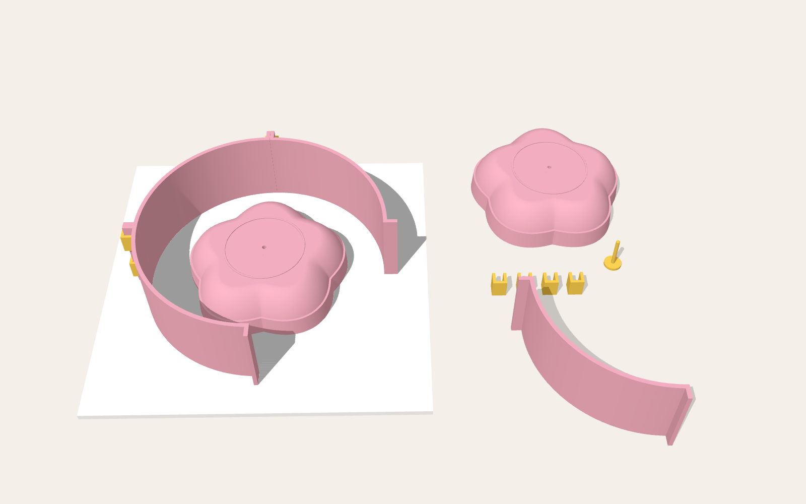
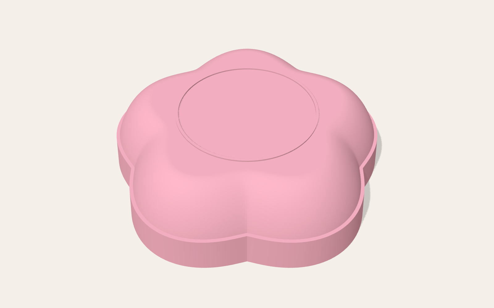
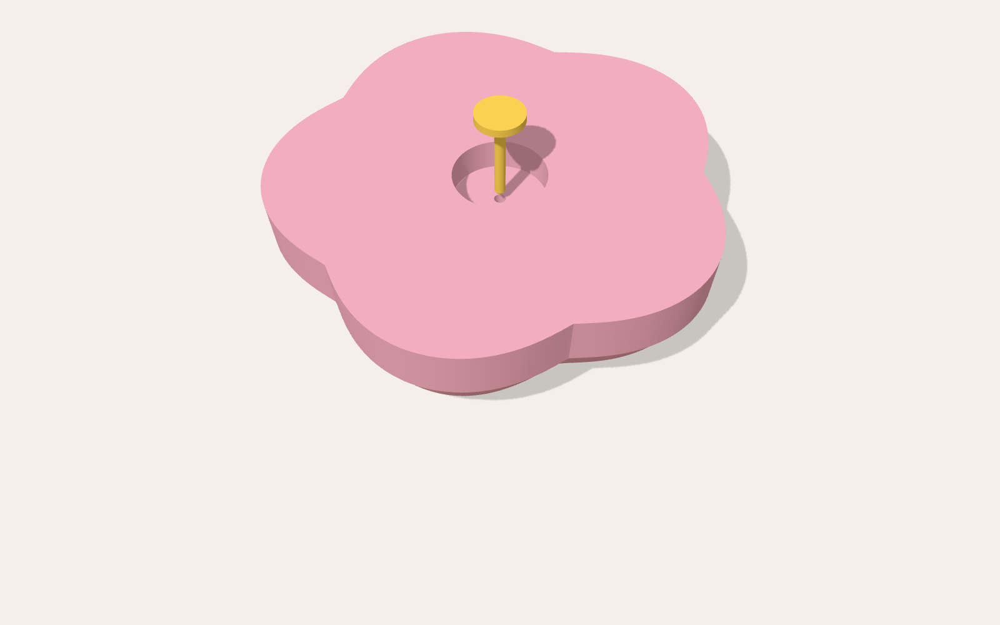
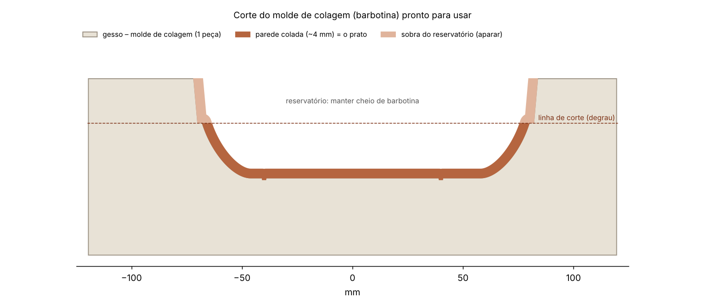
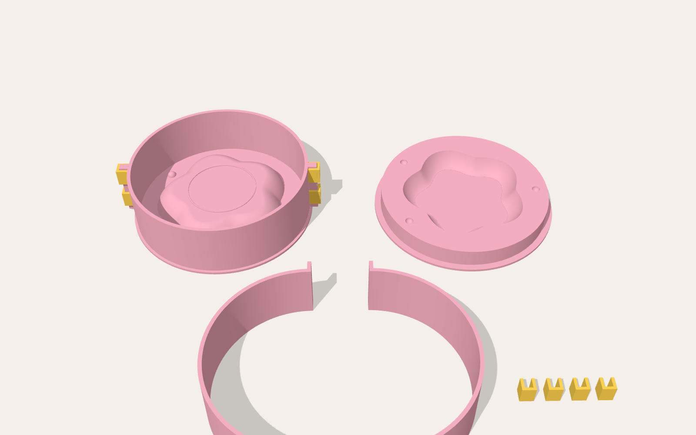
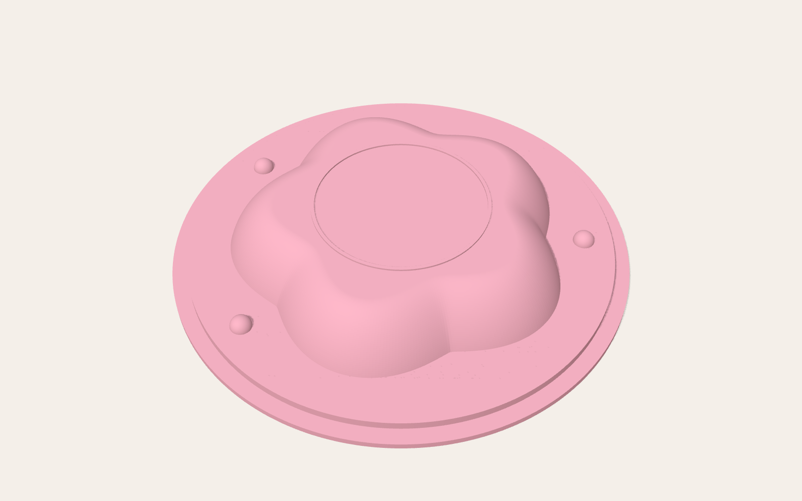
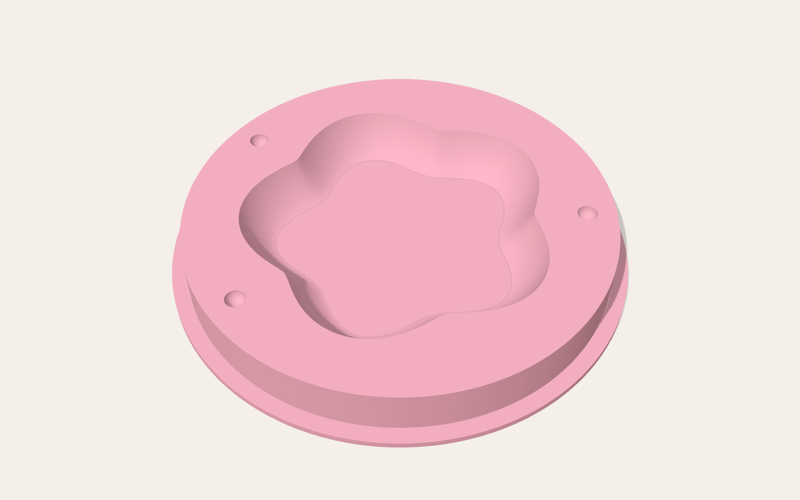

# Moldes 3D para gesso

Matrizes impressas em 3D para fazer moldes de gesso para cerâmica:

| | **Copo (barbotina)** | **Prato flor (barbotina)** | **Prato flor (prensagem)** |
|---|---|---|---|
| Como se usa | despeja-se barbotina, espera formar a parede e escorre-se o excesso | igual ao copo | aperta-se uma placa de argila entre duas peças |
| Peças de gesso | 1 | 1 | 2 (fêmea + macho) |
| Pasta | `stl/copo/` | `stl/barbotina/` | `stl/prensagem/` |
| Gerador | `gerar_copo.py` | `gerar_moldes.py` | `gerar_moldes.py` |

---

# Molde de copo (barbotina, 1 peça)

> Guia só do copo, para baixar ou imprimir: [GUIA_COPO.md](GUIA_COPO.md) · [GUIA_COPO.pdf](GUIA_COPO.pdf)

Copo com **fundo bem arredondado**, paredes que abrem levemente até a boca e **pé em anel** no fundo. A boca é a parte mais larga, então o copo sai do gesso por cima. O molde é **de uma peça só**, sem emenda na peça.

| Medida (peça crua, como sai do molde) | |
|---|---|
| Altura (com o pé) | **14 cm** |
| Boca (diâmetro externo, a parte mais larga) | **14 cm** |
| Parede | abre 3° até a boca, o que ajuda a desmoldar |
| Pé | **anel** com Ø 7 cm por fora, 6 mm de largura e **0,5 cm** de altura. O centro fica rebaixado. |


## Peças (pasta `stl/copo/`)


| Arquivo | Imprimir | O que é | Tamanho (mm) |
|---|---|---|---|
| `matriz_copo.stl` | 1x | O **copo de cabeça para baixo** sobre uma aba. A aba tem degraus que formam o encaixe do anel, o **reservatório** e o **degrau de corte**. Por dentro a matriz é **oca**, com um tubo central para o pino e 3 nervuras. | 214 × 214 × 172 |
| `anel_quarto.stl` | **4x** | 1/4 da parede de contenção (Ø interno 200 mm, 194 mm de altura). | 114 × 114 × 194 |
| `presilha.stl` | **12x** | Trava os quartos do anel, 3 por emenda. | 14 × 13 × 20 |
| `pino_desmolde.stl` | 2x | Pino Ø 6 mm que atravessa o tubo central e tampa o furo no fundo do copo. | Ø 20 × 166 |

| Matriz | Matriz por baixo: tubo central, nervuras e pino |
|---|---|
|  |  |

**Impressão:**
- A matriz vai com a aba na mesa, sem suportes. Use camada de 0,12–0,16 mm e 3–4 perímetros. O preenchimento quase não importa, porque a matriz já é oca.
- **Lixe bem** a parte do copo e passe primer e verniz: a barbotina copia tudo.
- O anel tem 194 mm de altura. A impressora precisa ter pelo menos 200 mm de altura útil.
- **Pino:** imprima em pé, com a cabeça na mesa, devagar e com 100% de preenchimento.
- **Alternativa ao pino:** uma **cavilha de madeira de 6 mm** cortada com 163 mm, ou uma vareta de 6 mm. Outra opção é tampar o furo do fundo, por fora, com uma bolinha de massinha bem rente. Na hora de desmoldar, o ar da seringa empurra a massinha.
- Passe uma broca de 6 mm no tubo central, de baixo para cima.

## Fazendo o molde de gesso

1. **Pino:** passe vaselina no pino e enfie-o por baixo, pelo tubo central, até a cabeça encostar. A ponta deve ficar rente ao centro do fundo do copo, dentro do anel do pé.
2. **Base:** apoie a matriz na mesa com a aba para baixo.
3. **Anel:** monte os 4 quartos do anel em volta do degrau da aba. O degrau **centraliza sozinho**. Prenda com 3 presilhas por emenda.
4. **Vedação e desmoldante:** vede as emendas por fora com argila e passe desmoldante na matriz e no anel.
5. **Gesso:** use consistência 70, com ~**3,8 kg de gesso** e ~**2,7 L de água**.
   1. Despeje pela lateral, sem jogar direto no copo, até a borda do anel. Isso deixa ~25 mm de gesso acima do pé.
   2. Bata na mesa para subir as bolhas.
6. **Desmolde:**
   1. Espere o gesso esquentar e esfriar (30–60 min).
   2. Tire as presilhas e o anel.
   3. **Vire o bloco** com a matriz ainda dentro, para a aba ficar para cima.
   4. Puxe o pino.
   5. Encaixe uma **seringa de 60 ml de bico cateter** no tubo central e injete ar ou água. A matriz se solta.
7. Chanfre as quinas e deixe o molde secar **7 dias**.

O bloco pronto tem **Ø 20 cm × 19 cm**. A face que estava na aba vira a boca do molde, com o reservatório e o degrau de corte.

## Colando o copo

1. **Encha:** com o molde seco e de boca para cima, encha de barbotina (1,75–1,80 g/ml) até o topo do reservatório. Vá completando enquanto o nível baixa.
2. **Espere a parede formar:** 10–25 min para 4–5 mm. Para conferir, raspe com a unha a barbotina na parede do reservatório.
3. **Escorra:** vire o molde de boca para baixo, apoiado em duas ripas, por 10–15 min.
4. **Corte:** quando o brilho sumir, corte a sobra do reservatório seguindo o degrau.
5. **Desenforme:** espere o copo se soltar sozinho, porque ele retrai e descola. Vire o molde sobre uma espuma.

O anel do pé de 6 mm costuma encher quase maciço de barbotina. É normal.

## Medidas e retração

As medidas são do copo **cru**. Na queima, a barbotina retrai uns 12–15%, então o copo sai do forno com ~12 cm.

Para o copo **queimado** ter 14 cm, gere o molde maior. Nesse caso a matriz e o anel deixam de caber numa mesa de impressão de 220 mm.

```bash
python3 gerar_copo.py --retracao 12 --preview
```

Outros formatos:

```bash
python3 gerar_copo.py --altura 120 --boca 120          # copo menor
python3 gerar_copo.py --saida-parede 6                 # paredes mais abertas
python3 gerar_copo.py --altura-curva 60                # fundo ainda mais arredondado
python3 gerar_copo.py --diametro-pe 60 --altura-pe 4   # outro pé
python3 gerar_copo.py --help
```

| Parâmetro | Padrão | Para que serve |
|---|---|---|
| `--altura` / `--boca` | 140 / 140 | medidas do copo (mm) |
| `--saida-parede` | 3° | quanto a parede abre até a boca. Mínimo de 2° para desmoldar. |
| `--altura-curva` | 45 | até que altura vai a curva do fundo. Maior = fundo mais arredondado. |
| `--diametro-pe` / `--largura-anel-pe` / `--altura-pe` | 70 / 6 / 5 | anel do pé |
| `--retracao` | 0 | % de retração. Use para o copo **queimado** ter as medidas. |
| `--altura-reservatorio` | 25 | sobra acima da boca |
| `--margem-gesso` | 25 | gesso em volta da boca e acima do pé |

---

# Prato flor: molde de colagem (barbotina)



## Peças (pasta `stl/barbotina/`)

| Arquivo | Imprimir | O que é | Tamanho (mm) |
|---|---|---|---|
| `matriz_barbotina.stl` | 1x | O **prato de cabeça para baixo**. Em cima fica o corpo do prato; embaixo, o **reservatório** de 20 mm com o **degrau de corte** de 2 mm na altura da borda. | 163 × 160 × 46 |
| `anel_quarto.stl` | **4x** | 1/4 da parede de contenção (Ø interno 240 mm, 80 mm de altura). | 134 × 134 × 80 |
| `presilha.stl` | **8x** | Presilha em "C". Vão 2 por emenda, uma embaixo e uma em cima. | 14 × 13 × 20 |
| `pino_desmolde.stl` | 1x (faça 2, por garantia) | **Pino de desmoldagem.** Tampa o canal de ar enquanto o gesso está líquido. | Ø 18 × 36 |

Todas as peças cabem numa mesa de impressão de 220 × 220 mm.

| Matriz (lado do prato) | Matriz por baixo: bolso, canal e pino |
|---|---|
|  |  |

### O pino de desmoldagem

O plástico liso da matriz gruda no gesso por **efeito ventosa**: na hora de tirar a matriz, forma-se vácuo entre os dois e ela não sai. Puxar com força pode lascar o molde.

Por isso a matriz tem um **canal de ar** de Ø 4 mm no centro. Ele vai do fundo do prato até um **bolso** na face de baixo.

- **Enquanto o gesso está líquido**, o pino fica encaixado no canal, com a ponta rente à superfície, para o gesso não entrar no furo.
- **Depois que o gesso endurece**, o bloco é virado, o pino sai e injeta-se **ar ou água com uma seringa** pelo canal. A pressão entra entre a matriz e o gesso, quebra o vácuo e empurra a matriz para fora.

### Em corte: fazendo o molde e o molde pronto



O molde é **um bloco de gesso só**, com a "boca" para cima.

- **Reservatório:** a barbotina fica nele acima da borda do prato. Assim o nível não baixa da borda enquanto o gesso absorve a água.
- **Degrau de corte:** marca exatamente onde aparar. Tudo o que colar acima dele é sobra.
- **Espessura do gesso:** ~35 mm nas laterais e embaixo, o que dá absorção suficiente para várias colagens seguidas.

## 1. Impressão da matriz

- PLA ou PETG, com camada de **0,12 mm**. A matriz sai na posição certa: o lado mais largo (o reservatório) fica na mesa, sem suportes.
- **Acabamento é essencial.** Na colagem, a barbotina copia até as linhas de camada.
  1. Lixe com grão 220 → 400 → 600, com água.
  2. Passe primer.
  3. Lixe de novo.
  4. Passe 2 demãos de verniz ou resina de acabamento (tipo XTC-3D).
- O anel e as presilhas podem ser impressos com 0,2–0,28 mm.
- **Pino:** imprima **em pé**, com a cabeça na mesa e 100% de preenchimento.
- **Canal:** depois de impresso, passe uma **broca de 4 mm** à mão pelo canal, de baixo para cima. Furos impressos costumam sair um pouco menores, e a broca deixa o encaixe certo.
- **Teste o pino.** Ele deve entrar justo e com a ponta rente ao fundo do prato. Se sobrar mais de 0,5 mm para fora, lixe a ponta. Se ficar para dentro, imprima outro com `--saliencia-pino` maior. Um pino curto demais deixa o gesso entrar e entupir o canal.

## 2. Montagem para despejar o gesso

1. Use uma **superfície lisa e plana**, como vidro, fórmica ou acrílico, de pelo menos 30 × 30 cm.
2. Passe um pouco de vaselina no pino e **encaixe-o no canal**, por baixo, até a cabeça encostar no fundo do bolso.
3. Apoie a matriz com o **lado largo (reservatório) para baixo**, no centro. O pino fica escondido dentro do bolso, sem encostar na mesa.
4. Vede a junção da matriz com a mesa com um cordão fino de argila ou massinha, para o gesso não entrar por baixo. Alise o cordão rente para não criar um degrau.
5. Monte os 4 quartos do anel em volta e prenda com **2 presilhas por emenda**.
6. **Centralize:** a distância do anel até a ponta de cada pétala deve ser parecida (~36 mm).
7. Vede por fora, com argila, as emendas do anel e a junção do anel com a mesa.
8. Passe **desmoldante** na matriz, no anel e na mesa. Pode ser vaselina líquida diluída, sabão de potássio ou desmoldante próprio para gesso. Tire o excesso com pincel.

## 3. Despejando o gesso

Use **gesso cerâmico** na consistência **70**: 70 partes de água para 100 de gesso, em peso.

| Mistura | Gesso | Água |
|---|---|---|
| ~2,9 L | **~2,9 kg** | **~2,05 L** |

Essa quantidade enche o anel até a borda e já inclui 10% de sobra.

1. Coloque a água no balde e polvilhe o gesso por cima, sem mexer. Deixe hidratar por 1–2 minutos.
2. Misture por 2–3 minutos, sem fazer bolhas, até ficar como um creme de leite grosso.
3. Despeje **pela lateral**, num fio contínuo, até a borda do anel. Isso deixa ~34 mm de gesso por cima da matriz.
4. Dê batidinhas na mesa por 1 minuto para subir as bolhas.
5. Espere o gesso esquentar e esfriar (30–60 min).
6. Tire as presilhas e o anel e **vire o bloco**, com a matriz ainda dentro. O lado que estava na mesa é a boca do molde, e o bolso com o pino fica para cima.
7. **Desmolde com o pino:**
   1. Puxe o pino. Se ele estiver preso, use um alicate.
   2. Encaixe o bico de uma seringa de 20–60 ml no canal e injete ar ou água devagar.
   3. A matriz se solta, e às vezes até "pula". Levante-a.
   4. Se ainda resistir, repita com água: ela não comprime e empurra mais forte.
8. Chanfre as quinas externas do bloco e a borda da boca.
9. **Secagem:** deixe secar por **7 dias** em local ventilado antes da primeira colagem. Se for usar estufa, não passe de 50 °C.

## 4. Colando o prato

1. Use **barbotina de colagem** (defloculada), com densidade de **1,75–1,80 g/ml**. Peneire e mexa bem antes de usar.
2. Com o molde **seco**, despeje a barbotina num fio contínuo até **encher o reservatório**.
3. Enquanto o gesso absorve, o nível baixa. **Complete** para manter o reservatório sempre cheio.
4. Espere a parede formar, normalmente entre **10 e 25 minutos** para 4–5 mm. Para conferir, raspe com a unha a barbotina na parede do reservatório e veja a espessura.
5. **Escorra:** vire o molde de boca para baixo sobre um balde e deixe pingar por 10–15 minutos, apoiado em duas ripas.
6. Desvire o molde. Quando o brilho sumir e a peça começar a descolar do reservatório (30–60 min), **corte com um estilete seguindo o degrau** e retire o anel de sobra.
7. Espere a peça se soltar sozinha (ela retrai e "descola"). Vire o molde sobre uma espuma ou tábua para desenformar.
8. Acabamento: passe uma esponja úmida na borda cortada.
9. Entre uma colagem e outra, deixe o molde secar. Um molde rende umas 2–3 colagens por dia.

> O lado de **fora** do prato (o fundo, com o anel do pé) copia o molde. O lado de **dentro** fica liso, formado pela própria barbotina.

O prato sai cru com **Ø 160 mm**. Com a retração da barbotina (12–15%), deve ficar com uns 14 cm depois da queima.

---

# Prato flor: molde de prensagem (placa de argila)



## Peças (pasta `stl/prensagem/`)

| Arquivo | Imprimir | O que é | Tamanho (mm) |
|---|---|---|---|
| `base_femea.stl` | 1x | Base com o **positivo** do prato em relevo e 3 bolinhas de registro. Gera o molde **fêmea** (côncavo). | 214 × 214 × 33 |
| `base_macho.stl` | 1x | Base com o **rebaixo** do prato (já descontados 6 mm de argila) e 3 covinhas de registro. Gera o molde **macho** (convexo). | 214 × 214 × 25 |
| `anel_metade.stl` | **2x** | Metade da parede da caixa (Ø interno 200 mm, 65 mm de altura). Serve para as duas bases. | 228 × 104 × 65 |
| `presilha.stl` | **4x** | Presilha em "C" que trava as abas do anel. | 14 × 13 × 20 |

| Base fêmea | Base macho |
|---|---|
|  |  |


A fêmea fica embaixo e o macho desce dentro dela. Entre os dois sobra um vão de **6 mm**, que é a espessura do prato. As chaves de registro só deixam encaixar numa posição.

## Passo a passo

1. **Impressão:** use as mesmas regras da matriz de colagem. As bases saem deitadas e o anel em pé. A metade do anel tem 228 mm, então numa mesa de 220 × 220 mm imprima na diagonal.
2. **Montagem:** encaixe as duas metades do anel no degrau da base e prenda com 2 presilhas por emenda. Vede as emendas com argila e passe desmoldante.
3. **Gesso:** use consistência 70. Para cada molde, encha até a borda do anel com ~1,6 kg de gesso e ~1,1 L de água.
4. **Molde fêmea:** despeje sobre `base_femea`.
5. **Molde macho:** despeje sobre `base_macho`, usando o mesmo anel.
6. **Secagem:** deixe os moldes secarem por 5–7 dias.
7. **Uso:**
   1. Abra uma placa de argila de 7–8 mm.
   2. Assente a placa na fêmea, com a cavidade para cima.
   3. Encaixe o macho com as bolinhas nas covinhas e pressione.
   4. Corte o excesso de argila rente à borda.
   5. Desenforme quando a peça chegar ao ponto de couro.

---

# Prato flor: mudando tamanho e formato

Todos os arquivos, dos dois moldes, saem do script `gerar_moldes.py`:

```bash
pip install numpy shapely trimesh manifold3d matplotlib scipy networkx
python3 gerar_moldes.py --preview          # gera stl/ e os desenhos em corte em imagens/
python3 gerar_moldes.py --help             # lista todos os parâmetros
```

Exemplos:

```bash
# Flor de 6 pétalas e mais funda
python3 gerar_moldes.py --petalas 6 --profundidade 30

# Prato menor, com contenção menor também
python3 gerar_moldes.py --raio-petala 65 --raio-vale 55 --largura-aba 18 \
    --raio-anel 85 --raio-anel-barbotina 105

# Reservatório mais alto, para peças com parede mais grossa
python3 gerar_moldes.py --altura-reservatorio 30 --altura-anel-barbotina 90

# Sem o anel em relevo que marca o pé
python3 gerar_moldes.py --marca-pe nao

# Presilhas mais frouxas (aumente) ou mais justas (diminua)
python3 gerar_moldes.py --folga-presilha 0.4
```

| Parâmetro | Padrão | Para que serve |
|---|---|---|
| `--petalas` | 5 | número de pétalas |
| `--raio-petala` / `--raio-vale` | 80 / 68 | raio na ponta e no encontro das pétalas |
| `--profundidade` | 25 | profundidade do prato |
| `--largura-aba` | 22 | largura da borda inclinada até o fundo plano |
| `--marca-pe` | sim | anel em relevo marcando o pé no fundo |
| **Colagem** | | |
| `--altura-reservatorio` | 20 | altura da sobra acima da borda |
| `--degrau-corte` | 2 | largura do degrau que marca o corte |
| `--saida-reservatorio` | 5° | inclinação da parede do reservatório (ajuda a desmoldar) |
| `--raio-anel-barbotina` | 120 | raio interno da contenção. O script avisa se sobrar menos de 30 mm de gesso ao lado das pétalas. |
| `--altura-anel-barbotina` | 80 | altura da contenção, que é a altura do bloco de gesso |
| `--segmentos-anel-barbotina` | 4 | em quantas partes imprimir o anel |
| `--canal-desmolde` | sim | canal de ar + pino de desmoldagem (`nao` para tirar) |
| `--diametro-canal` / `--diametro-pino` | 4,2 / 3,9 | furo do canal e haste do pino |
| `--saliencia-pino` | 0,2 | quanto a ponta do pino passa da superfície do prato |
| **Prensagem** | | |
| `--espessura-argila` | 6 | vão entre macho e fêmea |
| `--raio-anel` | 100 | raio interno da caixa de prensagem |
| `--altura-anel` | 65 | altura da caixa |
| `--folga` | 0,25 | folga entre o anel e a base |
| `--folga-presilha` | 0,3 | folga das presilhas nas abas do anel |

O script confere se todas as peças saem fechadas (*watertight*) e informa as medidas de cada uma e a quantidade de gesso para cada molde.
