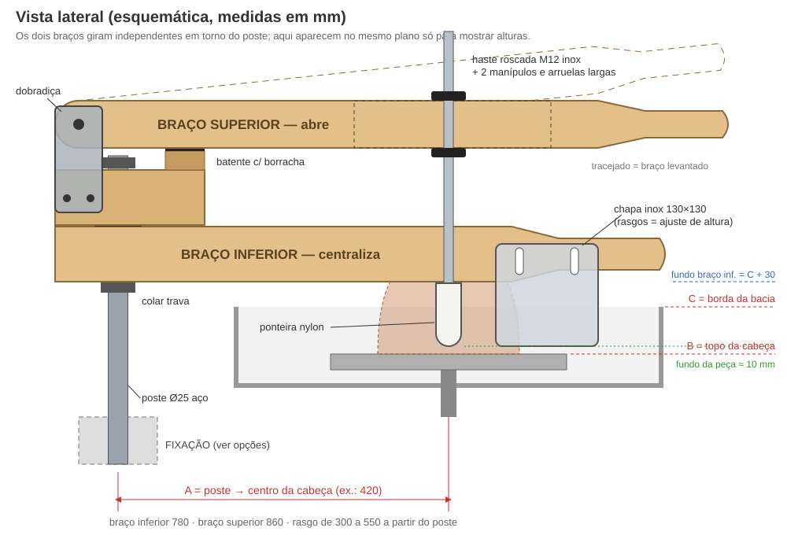
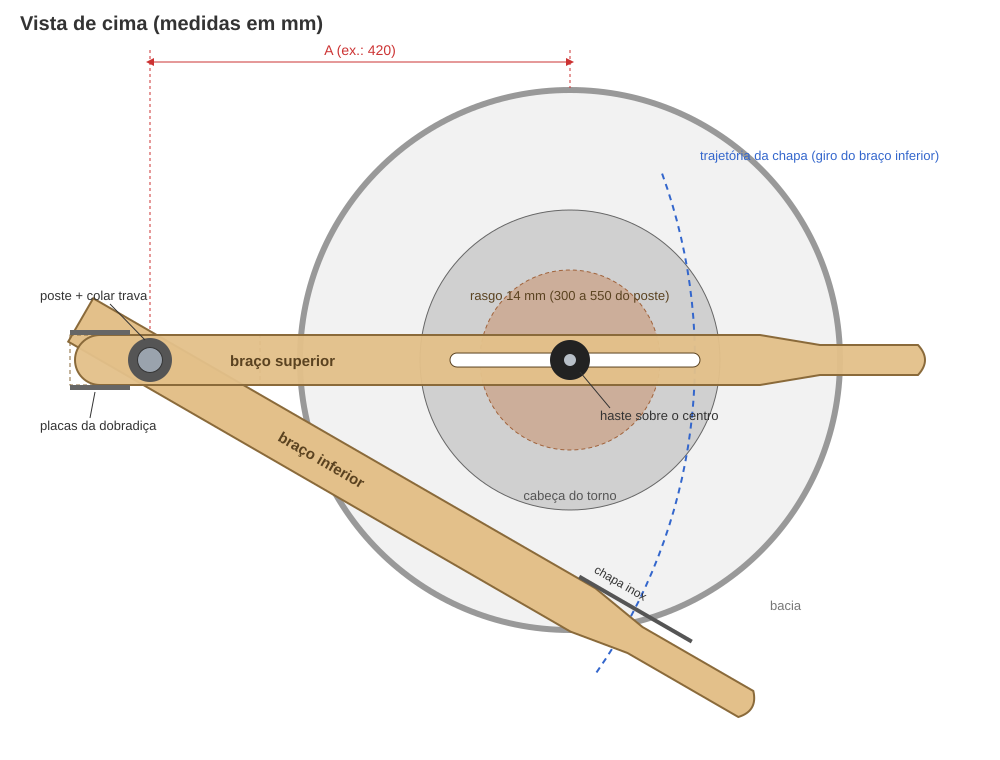

# Braço de centralizar e abrir para o torno Atman Bilha Hercules Pro

Projeto para fazer em casa (ou com marceneiro e serralheiro) um braço de alavanca parecido com o *Strong Arm Centering Tool*, adaptado ao torno Atman. O guia é **para uso próprio no ateliê**. O nome e a marca *Strong Arm* são do fabricante, então não use esse nome se um dia for vender.

---

## 1. Como o original funciona (pelas fotos)

| Peça | Função |
|---|---|
| **Poste vertical** preso ao torno (grampo "C" no tampo) ou ao chão (coluna com flange) | Eixo onde tudo gira. A altura é regulada com um **colar trava** (anel com parafuso allen). |
| **Braço inferior** (madeira), com uma **chapa de inox** na lateral | Gira na horizontal. Você empurra o cabo e a chapa pressiona o barro contra o centro enquanto o torno gira. Isso é a **centralização**. |
| **Bloco** sobre o braço inferior | Gira no mesmo poste, **independente** do braço inferior. Na foto 2 dá para ver os dois braços em ângulos diferentes. |
| **Braço superior** articulado no bloco por **placas laterais aparafusadas** (dobradiça) | Sobe e desce como uma alavanca e também gira na horizontal junto com o bloco. |
| **Haste vertical** presa num **rasgo** do braço superior, com **ponteira arredondada** | Ao descer o cabo, a ponteira entra no barro. Isso é a **abertura**. Depois, girando o braço, você alarga o fundo. A posição no rasgo ajusta a distância até o centro. |

A vantagem está na **alavanca**. Com a mão a ~75 cm da articulação e a haste a ~47 cm, a força chega ao barro multiplicada por ~1,6. Empurrando o cabo com 15 kgf, a ponteira faz ~24 kgf, sem forçar punho e ombro.

---

## 2. Antes de tudo: medir o seu torno Atman

### Modelo escolhido: Hercules Pro (Atman Bilha)

Pelo que a loja divulga (dados obtidos por busca, sem abrir a página):

- **Disco (cabeça):** Ø 300 mm
- **Motor:** 1 HP, até 60 kg de barro, 0–250 rpm, botão *Half Speed*
- **Bacia:** magnética e removível

O que isso muda no projeto:

- **Disco de 300 mm:** é o mesmo dos desenhos, então as medidas de exemplo (A = 420, rasgo de 300 a 550 mm do poste, chapa a 480–610 mm) já servem como ponto de partida. Só ajuste A depois de medir o diâmetro externo da bacia: o poste fica logo fora dela.
- **Não prenda nada na bacia.** Ela é removível e de plástico, então o poste tem que ir no **corpo ou chassi do torno**, ou no chão.
- **Altura do torno:** a loja não informa se a altura do Pro é regulável. Se for, prenda o poste **no corpo do torno**, na parte que sobe e desce junto com o disco, para o braço acompanhar sem reajuste.
- O "Centralizador Universal" que a Atman vende é outro tipo de acessório: ele segura a peça no disco, não é um braço de alavanca.

### Medidas que faltam

As medidas abaixo ainda precisam ser tiradas no seu torno. As medidas dos desenhos continuam sendo um **exemplo**. Meça e anote:

| Letra | O que medir | Para que serve |
|---|---|---|
| **A** | Distância horizontal do ponto onde o poste vai ficar até o **centro da cabeça** | Posição do rasgo e da chapa |
| **B** | Altura do chão até o **topo da cabeça** | Altura da chapa e da ponteira |
| **C** | Altura do chão até a **borda da bacia** (splash pan) | Altura do braço inferior |
| **D** | Diâmetro da cabeça e diâmetro externo da bacia | Para o braço passar por cima |
| **E** | Onde dá para prender: há **tampo/mesa plana** ao lado da bacia? Qual a espessura? As **pernas/chassi** são de tubo? De qual medida? | Escolher a fixação (seção 5) |
| **F** | De que lado você trabalha e para que lado a cabeça gira | O poste fica **atrás e ao lado** da mão que não empurra, sem atrapalhar o pedal |

**Regra prática para o lugar do poste:** logo fora da bacia, de modo que **A fique entre 350 e 500 mm**. Se A der outro valor, desloque o rasgo para que ele vá de **A − 120** até **A + 130** a partir do poste.

> Se você me mandar fotos do torno (de lado, de cima e da estrutura por baixo) com uma trena aparecendo, eu ajusto todas as medidas e escolho a fixação certa.

---

## 3. Medidas propostas (exemplo com A = 420, B = 520, C = 580)

Todas as distâncias "do poste" são medidas a partir do **centro do poste**.

### Braço inferior (centralizador)
- **Caibro aplainado 5 × 7 cm**, 780 mm de comprimento (fica em pé: 50 de largura, 70 de altura).
- Furo do poste a **80 mm da ponta traseira**.
- Cabo: os últimos ~200 mm afinados e arredondados até Ø 35–40 mm.
- **Altura:** a face de baixo fica a **C + 30 mm**, para passar sobre a bacia com folga.

### Chapa centralizadora
- **Inox 304, 2 mm**, 130 × 130 mm, cantos arredondados (raio 8) e bordas lixadas.
- Aparafusada na **lateral** do braço inferior, entre **480 e 610 mm do poste**.
- Dois **rasgos verticais** (10 × 35 mm) para regular a altura. A borda de baixo fica **5 a 10 mm acima da cabeça** e nunca deve encostar nela.

### Bloco
- Madeira 5 × 7 cm, **190 mm** de comprimento, apoiado sobre o braço inferior.
- Mesmo furo do poste, alinhado com o do braço inferior.
- Entre o bloco e o braço vai uma **arruela de nylon/teflon**, para os dois girarem soltos.
- Na frente, em cima, um **batente** de madeira 50 × 50 × 26 mm com **borracha** colada. Ele define até onde o braço superior desce.

### Braço superior (abridor)
- **Caibro 5 × 6 ou 5 × 7 cm**, 860 mm.
- Ponta traseira **arredondada em meia-lua** (raio 30) centrada no furo da articulação, para não bater no bloco quando levanta.
- **Rasgo passante de 14 mm**, de **300 a 550 mm do poste**. Para fazer: furos de 14 mm nas pontas e tupia ou serra tico-tico entre eles.
- Cabo afinado nos últimos ~170 mm.

### Dobradiça
- **2 placas** de barra chata de aço 1½" × 3/16" (38 × 4,8 mm), 135 mm cada, uma de cada lado.
- **Pivô:** parafuso sextavado **M10 × 70** + porca **autotravante (parlock)** + 2 arruelas, passando pelo braço superior a 30 mm da sua face de baixo.
- **Fixação no bloco:** 2 parafusos **M8 × 70** passantes, com porcas autotravantes.
- Use bucha de latão ou um pedaço de tubo no furo do pivô para a madeira não ovalizar.

### Haste e ponteira
- **Barra roscada inox M12**, 450 mm.
- Presa no rasgo por **2 arruelas largas (Ø 40)** e **2 manípulos fêmea M12** (ou porcas borboleta), um em cima e outro embaixo do braço. Girando os manípulos você sobe ou desce a haste.
- **Ponteira:** tarugo de **nylon ou poliacetal Ø 32 × 80 mm**, ponta em meia-esfera e furo roscado M12 (qualquer tornearia faz). Se quiser, cubra a parte de cima com espuma ou mangueira, como o original.

### Poste e eixo
- **Barra redonda de aço Ø 25 mm**, de preferência inox 304. Se for aço 1020, pinte ou zinque.
  - ~400 mm para fixação no tampo ou no chassi; ~1000 mm para coluna de chão.
- **2 colares trava de 25 mm**: um embaixo do braço inferior (regula a altura) e um em cima do bloco (impede o bloco de subir quando você força a alavanca).
- **Buchas:** nos furos do braço e do bloco, buchas de **nylon/tecnil 32 × 25 × 70 mm** prensadas em furo de 32 mm. Não use rolamento comum, porque a barbotina destrói.

---

## 4. Lista de compras

| Item | Qtde | Onde comprar |
|---|---|---|
| Caibro aplainado 5 × 7 cm, madeira dura (cumaru, garapeira, jatobá ou eucalipto) | ~2 m | Madeireira |
| Chapa inox 304 2 mm, 130 × 130 | 1 | Serralheria / corte a laser |
| Barra redonda Ø 25 mm (inox ou 1020) | 0,4–1 m | Loja de aço |
| Colar trava (anel de fixação) 25 mm | 2 | Loja de rolamentos / ferragens |
| Bucha de nylon 32 × 25 × 70 | 2 | Tornearia |
| Arruela de nylon/teflon 25 mm | 1 | Tornearia / ferragens |
| Barra chata aço 1½" × 3/16", 135 mm | 2 | Serralheria |
| Parafuso M10 × 70 + porca parlock + 2 arruelas | 1 jogo | Ferragens |
| Parafuso M8 × 70 + porca parlock + arruelas | 2 jogos | Ferragens |
| Barra roscada inox M12 | 450 mm | Ferragens |
| Manípulo fêmea M12 (ou porca borboleta) + arruela larga Ø 40 | 2 + 2 | Ferragens |
| Tarugo nylon/poliacetal Ø 32 × 80 | 1 | Tornearia |
| Parafusos inox M6 + porca borboleta (fixar a chapa) | 2 | Ferragens |
| Borracha para o batente | 1 retalho | — |
| Verniz marítimo ou óleo de tungue/linhaça | 1 | Loja de tintas |
| Itens da fixação escolhida (seção 5) | — | Serralheria |

---

## 5. Como prender no torno Atman (escolha uma)

**Opção 1: grampo no tampo** (como a foto 3). Serve se o Atman tiver uma mesa ou tampo plano e firme ao lado da bacia.
- O serralheiro faz um "C" de barra chata 2" × ¼" com um **tubo-soquete** soldado na vertical (tubo de aço 1", sch 40, ID ≈ 26,6 mm, com o poste de 25 mm dentro).
- Aperto por parafuso M12 com sapata. Ponha borracha nas faces que encostam no tampo.

**Opção 2: abraçadeiras no chassi** (recomendada se as pernas ou a estrutura forem de tubo). É a fixação mais firme e não precisa furar nada.
- Um tubo-soquete vertical preso a uma perna com **2 grampos "U"** (abraçadeiras de vergalhão) e uma chapinha de apoio.

**Opção 3: coluna de chão** (como a foto 5). Serve para qualquer torno.
- Tubo de aço 1½" com **flange de 200 mm em chapa ¼"** e soquete no topo para o poste.
- Prenda no piso com 4 parabolts. Se não puder furar o chão, faça uma **base larga em que o próprio torno fica em cima de uma das abas**: o peso do torno segura a coluna.

Em qualquer opção o poste **não pode balançar**. A força de empurrar a chapa gera ~60 N·m no ponto de fixação. O aço de 25 mm aguenta com folga, mas uma fixação frouxa vai descentralizar o barro.

---

## 6. Passo a passo

1. **Medir o torno** (seção 2) e recalcular A, a posição do rasgo e as alturas.
2. **Fixação:** fazer ou encomendar o grampo, as abraçadeiras ou a coluna. Instalar e conferir o prumo do poste com nível.
3. **Madeira:** cortar o braço inferior, o bloco, o braço superior e o batente.
   - Furar os Ø 32 das buchas **em furadeira de bancada**. Os furos precisam ficar perfeitamente verticais, senão os braços "sobem ladeira" ao girar.
   - Fazer o rasgo de 14 mm e arredondar a traseira do braço superior.
   - Afinar e lixar os cabos.
4. **Acabamento:** 3 demãos de verniz marítimo ou óleo, porque o braço vive molhado de barbotina. Prensar as buchas de nylon.
5. **Dobradiça:** furar as duas placas juntas (presas com grampo) para os furos coincidirem. Furar o bloco e o braço superior usando a placa como gabarito. Montar o pivô **sem apertar demais**: o braço deve cair sozinho, sem folga lateral.
6. **Chapa:** fazer os rasgos, lixar as bordas e aparafusar na lateral do braço inferior.
7. **Haste:** rosquear a ponteira na barra M12 e montar no rasgo com arruelas e manípulos.
8. **Montagem no poste**, de baixo para cima: colar trava, braço inferior, arruela de nylon, bloco (com o braço superior), colar trava de cima.

---

## 7. Ajustes e uso

- **Altura do braço inferior:** com o colar de baixo, o braço fica **3 cm acima da borda da bacia**.
- **Chapa:** a borda de baixo fica **5 a 10 mm acima da cabeça**. Ajuste pelos rasgos.
- **Fundo da peça:** abaixe o braço superior até o batente. Com os manípulos, ajuste a haste até a ponteira ficar a **~10 mm da cabeça**, que é a espessura do fundo. Assim o batente impede de furar o fundo ou bater na cabeça.
- **Centralizar:** com o torno em velocidade média e o barro molhado, apoie a chapa no barro e empurre o cabo do braço inferior aos poucos, subindo e descendo o barro (cone) com a outra mão se quiser.
- **Abrir:** afaste o braço inferior. Gire o braço superior até a ponteira ficar sobre o centro e desça o cabo devagar até o batente. Para alargar o fundo, mantenha o cabo embaixo e gire o braço para fora.
- **Fora de uso:** levante o braço superior e gire os dois braços para fora da área do torno.

---

## 8. Segurança e cuidados

- Nada de cabelo solto, cordões ou mangas largas perto do poste e da cabeça girando.
- Teste primeiro **com o torno desligado**: gire os braços por todo o curso e confira que nada bate na cabeça, na bacia nem nas suas pernas e no pedal.
- Comece com pouca força e velocidade média. A alavanca multiplica a força, e um barro descentralizado pode "pegar" a chapa.
- Lave depois de usar e passe uma gota de óleo no pivô e nas buchas de vez em quando.
- Não use rolamentos nem peças de aço carbono sem proteção: a barbotina oxida tudo.

---

## 9. Próximos passos

Mande as medidas (A–F) e fotos do seu Atman, que eu:
- recalculo todas as cotas para o seu torno;
- desenho a fixação específica (grampo, abraçadeira ou coluna) com medidas para o serralheiro;
- monto uma folha de corte em PDF para levar à madeireira e à tornearia.
